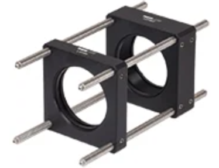

# 29/10/2026 :

Discussion avec le big C sur mon sujet :

## Le Bragg :

- Checker sur Newport et Coherent aussi.

## Le setup : 

### Lien focale, diamètre et N.A :

- Attention à l'ouverture numérique de la lentille objectif : plus la focale est grande, plus le diamètre doit être grand pour que la lentille capte une partie importante du rayonnement.

### Fibre dans la tige de la lentille objectif

- Il faut donc probablement faire passer la fibre dans la tige de la lentille (Ou dans sa monture ? Un trou d'un mm de rayon serait amplement suffisant. Il faudrait juste éviter dans l'idéal la vis qui maintient la monture à la tige).

### Tige au milieu du piezotube

- Il faudrait aussi mettre la tige au milieu du piezotube. Cela impose un diamètre pour la tige et pour le piezo. J'imagine bien un [PT230.24](https://www.pifrance.fr/fr/products/piezoelectric-transducers-actuators/pt230-pt-piezo-scanner-tubes-103150#variants), de hauteur 30 mm, diamètre extérieur 10 mm, diamètre intérieur 9 mm (épaisseur de 0.5 mm), et qui bouge sur $\pm$ 10 um en XY et $\pm$ 4.5 um en Z. La tige sera probablement une [MSR/M](https://www.thorlabs.com/mini-series-optical-posts?tabName=Overview), qui fait 6mm de diamètre. Il faudra la trouer.

### Résonances

- Il faut éviter de trop déporter les optiques (genre le DBR), car cela va induire des résonances pourries. Et on veut qqchose de stable par rapport au centre du bow tie (donc au nanometre).
    - Peut on couvrir la platine par une petite plaque en alu, qui dépasse sur un bord, pour déporter le DBR avec l'échantillon, tout en le gardant stable et droit ? On cherche une solution à l'encombrement.

### Déporter l'excitation arrière 

- On peut en revanche avancer l'excitation arrière avec ce genre de truc : (Cage mounts et cage rods chez thorlabs)

  

On se fiche pas mal que l'excitation arrière ait un grand bras de levier, tant que les vibrations sont faibles devant 1300 nm, la limite de diffraction.

### Fuite de la cavité dans le substrat et hBN

- Si le waist du mode fait 5 um, et que le substrat présente une cassure (le bord d'une flake) à moins de 15 um, on sait que seuelment 99% de la lumière va être couplée (exponentielle à 3 sigma). Ca donne une cavité pourrie (99% de reflection côté DBR max). Finesse nulle, couplage nul.

- C'est la raison principale de la matrice de polystyrène plutôt que du hBN pour les échantillons ici. Mais avec le bowtie, le volume de mode est tellement faible que ça ne devrait pas être un problème du tout !

### Autre changement avec le PS et le hBN

Selon la hauteur de l'émetteur dans le polystyrène par rapport au DBR, le diagramme de rayonnement va être super différent. De plus, le bonne configuration (proche ou loin du DBR) change selon l'indice de la dernière couche. Avec le hBN, on sait l'épaisseur du sustrat, et on sait laquelle mettre pour avoir un diagramme de rayonnement adéquat.

