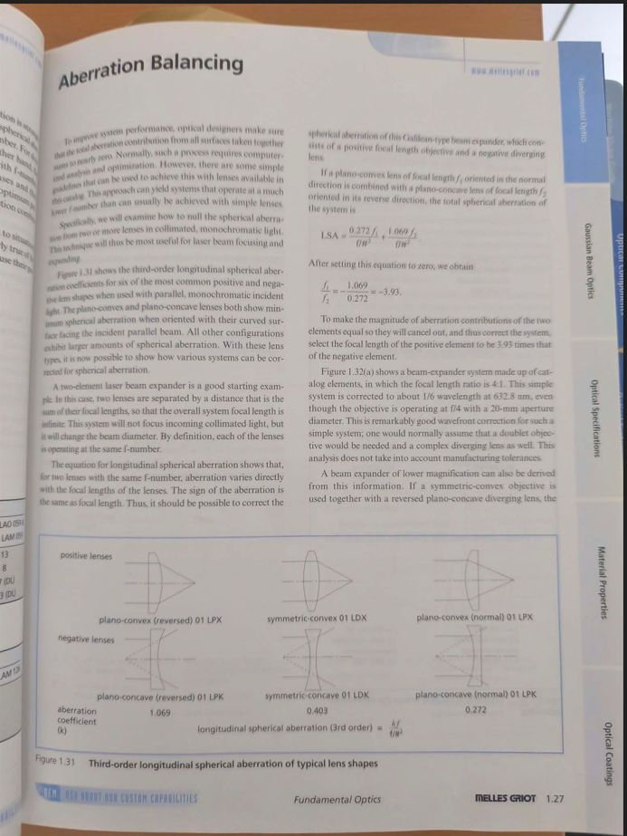
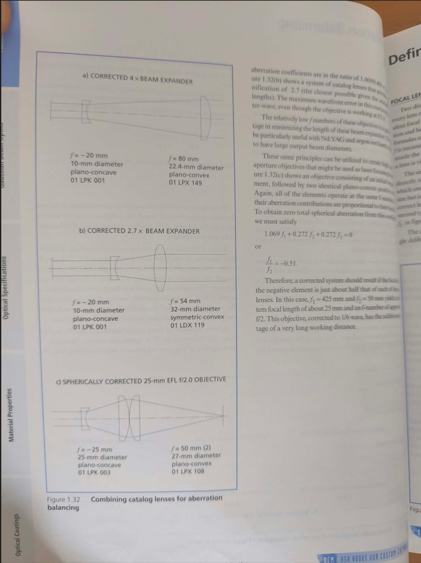

# Discussion avec Yannick aprem 04/11/2026 :

## Visu lampe blanche :

- Pas possible de faire en "transmission" :
    - Même avec un dépoli, l'ombre ne va pas exister bien longtemps.
 
- Il faut utiliser une lentille pour focaliser sur l'échantillon :
    - La fibre se trouve à une distance focale de la lentille
    - Le faisceau collimaté de la diffusion de la fibre ressort de la boîte
    - On le focus sur une caméra en dehors de la boîte
    - La fibre diffuse la lumière !!!!
    - Mettre 

- On peut éclairer avec n'importe quelle source incohérente de lumière :
    - Genre un ruban de LED !
    - Si ça vient de autour de la lentille, c'est top : comme un photographe à l'époque avec la parapluie

- Gloabalement, c'est à faire à la fin, selon la place dsipo, et en testant :
    - Pas d'IA, bricolage only !!

- Regarder la thèse de Théo, page 236, pour le reflet de la fibre dans le DBR.

- On peut utiliser la lumière, genre rouge, dans la fibre. Mais c'est nécessairement moche, étant donné que c'est cohérent et que ça va interferer.

- On peut aussi, avant de collimater sur la caméra en dehors de la boîte, utiliser un filtre de couleur pour selectionner une partie du visible plutôt que tout. Ca permet de faire une image moins vilaine, sans rendre le truc cohérent.

## Excitation arrière :

- Les tests de Yannick :
    - Il a envoyé un faisceau collimaté dans l'asphérique et sa lentille sur mesure
    - Il a mis une plaque de 3 mm de verre pour simuler le substrat
    - Il a mis un miroir en bout de course et il a regardé a réflection à travers l'asphérique et sa lentille
        - Le faisceau passe 2 fois asphérique et lentille sur mesure
        - Le faisceau passe une fois dans un objectif 
    - Il fait 600-800 nm de largeur.

- Il faut que le faisceau fasse 1" pour matcher la lentille asphérique :
    - Sinon on ne profite pas de l'ouverture numérique de 0.67, parce qu'on ne vient pas taper les bords.
    - Il faut donc placer un téléscope entre le collimateur et la grosse asphérique.
        - Ce n'est pas envisageable de sortir de la fibre d'excitation avec un diamètre de 1 pouce, c'est énorme par rapport à tous les miroirs et tout.
    - Il faut un grossissement Gamma de 10 environ (sortie de collimateur la plus grosse à 3.6 mm de waist mode, 1" = 22 cm à peu près)
    - 2 façons de faire un téléscope point de vue optique géométrique :
        - f1 + f2 et on laisse le faisceau se focus et se défocus
        - f1 - f2 et on ne laisse pas le faisceau se focus complétement.
    - Plusieurs façons de faire un téléscope point de vue optique réelle :
        - Plein de type de lentilles possibles !!
            - 
            - 

    - Potentielle très bonne idée :
        - Utiliser l'asphérique de Edmunds pour ça : la même !!
        - Utiliser une autre lentille (un peu comme la sur mesure) pour faire l'autre côté.
        - A creuser !!!

    - Le but de l'arrière, c'est d'être le plus propre possible au niveau de l'excitation (pas à la longueur d'onde de collection)!
        - "tant pis" pour la collection. Il faudra un dichroic après le téléscope, on collectera dans une multimode comme on pourra.

## 4f :

- Pour le 4f et le steering mirror :
    - Les f du 4 f doivent être grandes (devant l'épaisseur des lentilles).
    - Ca fait 20x4=80 cm, ça ne tiendra jamais dans la boîte.
    - Il y a une lentille objectif à la fin du 4f.
    - C'est cette lentille qui donne la précision : le déplacement au niveau de l'échantillon vaut f*theta
    - Ca vient de la trigo + petits angles.
    - Pour une focale de 3mm et un pas de 100 nm sur l'échantillon, il faut une resolution de 30 micro radians.

    - Toujours vérifier la réproducibilité du steering, c'est le juge de paix : pas de stick and slip, seulement de la déformation linéaire selon la tension : fonctionnement piézo classique.

## Piezo tube :

- Regarder le fonctionnement dans le détail :
    - Un piezotube scanner en XY, est-ce qu'il contrôle son Z, où est-ce que c'est une conséquence ?
        - Demander à l'IA ce qu'elle comprend.
        - Demander aussi à l'IA un petit calcul d'ordre de grandeur pour la rayon de courbure quand on bouge un axe
    - Comment on colle le piezo ?
        - Quel type de colle ?
        - Sur quoi on colle ?
        - Est-ce que PI vend ça ?

# Chose à faire :

- Regarder colle :
    - On veut coller la petite lentille sur mesure à la monture faite par le gars de l'atelier 
    - C'est de la colle optique de chez thorlabs
    - Pas de la colle UV idéalement, plutôt de la colle "glass to metal"
    - Si ça se démonte avec du solvant, c'est cool !!!

- Regarder téléscope et lentilles adaptées :

- Regarder devis Lesker :
    - Sans USB
    - Avec fenetre en QF40
    - Avec fenetre en grand (ISO100)
    - Quelle épaisseur ça fait ces vitres ? 

- Regarder la différence entre distance de travail et focale effective :
    - La focale effective est tout ce qui intervient dans les calculs d'optique.
    - La distance de travail rend compte de la distance à laquelle une optique doit être positionnée de l'objet en rapport.
    - Exemple : La C330 de chez thorlabs. Elle a une focale équivalente de 3.1 mm même si on bosse à 1.7mm de l'objet.
