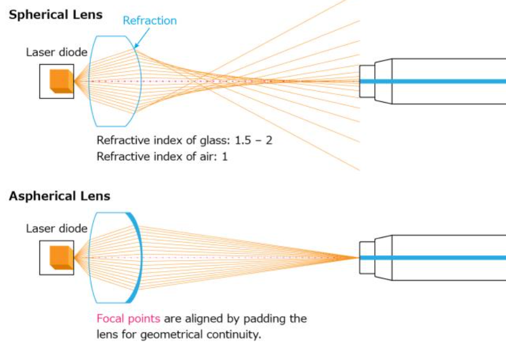
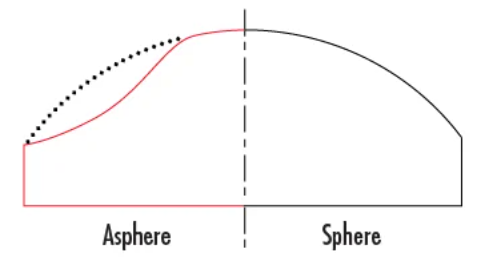
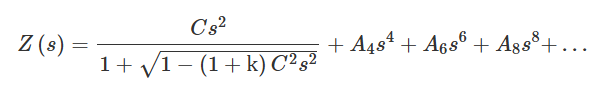

# Lentille asphérique

-Une lentille asphérique permet de gommer les abérrations optiques quand on sort des petits angles (Gauss). On peut ainsi avoir une N.A plus élevée.
    - Elle permet de mieux focaliser les rayons qui arrivent loin de l'axe optique.

Voila la différence concrète dans la forme d'une asphérique et d'une sphérique : 

-La forme et la correction qu'apporte une asphérique dépend d nombre de corrections polynomiales prise en compte dans sa conception : 