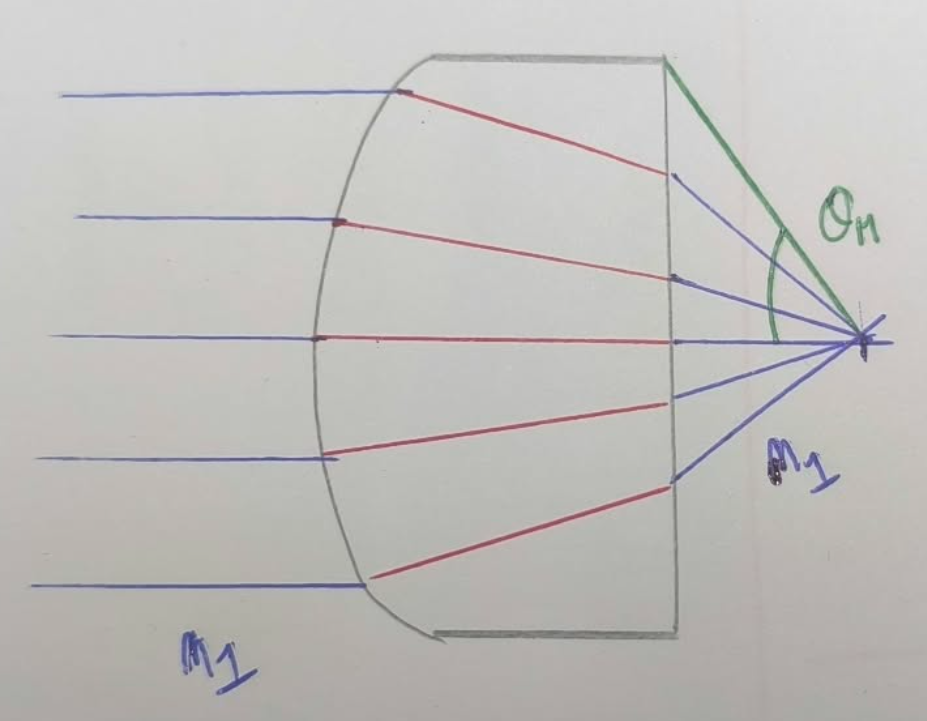

# Ouverture numérique

- L'ouverture numérique caractérise la proportion de lumière émise par un point qu'une optique (lentille) peut capter :
    - Elle dépend de l'indice du milieu dans lequel le point qui émet les rayons se trouve (le milieu dans lequel la lentille est)
    - Elle dépend également de la taille de la lentille elle-même. 

Sur le schéma, l'angle max accepté par la lentille est $\theta_M$ 