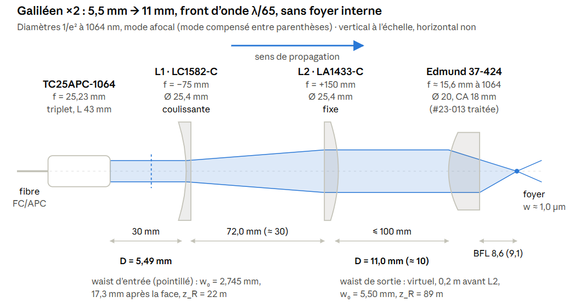

# Fabrication du téléscope pour l'arrière :

## Problématique

- On a pour l'arrière :
    - Une fibre optique qui amène l'excitation (longueur d'onde à définir, en gros 1000 nm).
    - Elle est connectée à travers un collimateur de type [TC25FC-1064](https://media.thorlabs.com/globalassets/items/t/tc/tc2/tc25fc-1064/stn012201-e0w.pdf?v=0116031153) (waist du mode de 5,5 mm) ou [F280APC-1064](https://media.thorlabs.com/globalassets/items/f/f2/f28/f280apc-1064/ttn030851-e0w.pdf?v=0116112340) (waist du mode de 4,05 mm) ou bien même le [F810APC-1064](https://media.thorlabs.com/globalassets/items/f/f8/f81/f810apc-1064/ttn030707-e0w.pdf?v=0116112435) qui permet d'avoir un mode waist de 8.00 mm en sortie.
    - On doit agrandir le faisceau avec un beam expender, d'un facteur qui dépend du collimateur qu'on a choisi. Mais le diamètre de fin doit être 1" (20 cm en vrai), pour rentrer dans la [lentille asphérique 37-424 de chez Edmunds](https://www.meetoptics.com/lenses/aspheric/polished-aspheric-lens/s/edmund-optics/p/22-998_22-999_23-013_37-424_37-424-ink?option=%2337-424).
    - On ne veut pas d'abérrations optiques induites nulle part si possible. Il n'y en aura pas après l'asphérique de chez Edmund. Je ne veux pas en induire entre la sortie de la fibre et la fin du téléscope, le but étant d'avoir une excitation la plus propre possible.

## Propal de télescope :

### Principe :

Le montage repose sur un collimateur fibré Thorlabs TC25APC-1064, qui transforme la lumière issue de la fibre en un faisceau laser quasi parallèle d'environ 5,5 mm de diamètre. Ce faisceau traverse ensuite un télescope galiléen grossissant ×2, constitué d'une lentille divergente de focale −75 mm (LC1582-C), suivie d'une lentille convergente de focale +150 mm (LA1433-C). Ce dispositif permet de porter le diamètre du faisceau à environ 11 mm, tout en conservant une bonne qualité de front d'onde. Les deux lentilles sont maintenues coaxiales par un système de cage optique de 30 mm, qui assure leur alignement mécanique. La première lentille est montée sur une plaque coulissante afin de régler précisément sa distance à la seconde : ce réglage permet non seulement de passer d'une configuration afocale (faisceau collimaté) à une configuration légèrement divergente, mais aussi de compenser en partie les aberrations sphériques introduites par l'asphère finale à 1064 nm. Le faisceau élargi est ensuite dirigé vers l'asphère, avec deux miroirs de renvoi permettant d'ajuster son pointage et son centrage.

### Schéma :

### Optiques retenues dans le détail, et dans l'ordre d'apparition :

- Collimateur : [TC25APC-1064](https://www.thorlabs.com/item/TC25APC-1064)
- Adaptateur : [AD12F](https://www.thorlabs.com/item/AD12F)
    - Passe du 12 mm du collimateur vers SM1
- Adaptateur : [CP33_M](https://www.thorlabs.com/item/CP33_M)
    - Adaptateur du SM1 vers cage mount
    - Coulisse le long du cage mount
    - Se fixe à l'endroit voulu sur le cage mount grâce à des vis.

- Lentille L1 : [LC1582-C-ML](https://www.thorlabs.com/item/LC1582-C-ML)
    - Elle est déjà monté sur du SM1
    - On utilise à nouveau [CP33_M](https://www.thorlabs.com/item/CP33_M) pour la maintenir dans la cage
    - f = -75 mm

- Lentille L2 : [LA1433-C-ML](https://www.thorlabs.com/item/LA1433-C-ML)
    - Pareil : déjà montée et il faut [CP33_M](https://www.thorlabs.com/item/CP33_M)

- Tige de la cage : [ER6-P4](https://www.thorlabs.com/item/ER6-P4)
- Iris sur cage mount : [SM1D12D](https://www.thorlabs.com/item/SM1D12D)
- Bague pour tenir : [SM1RR](https://www.thorlabs.com/item/SM1RR)