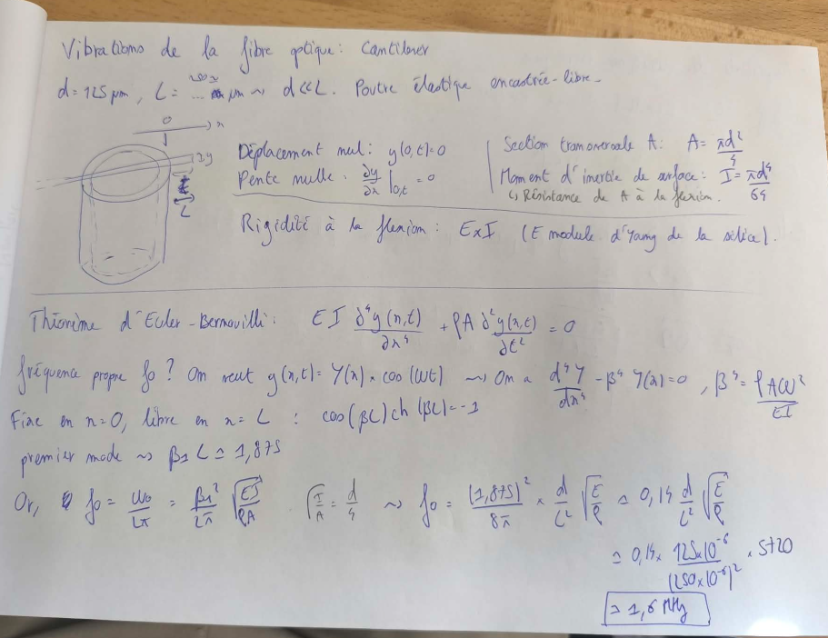
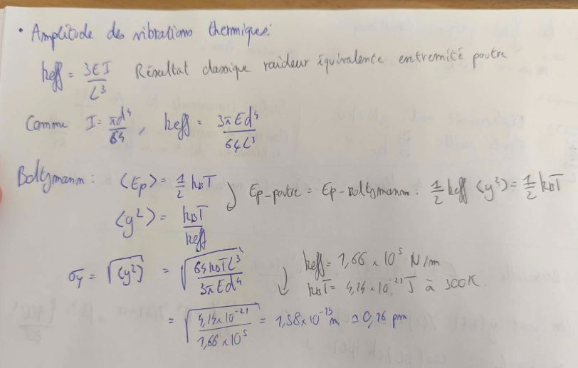

# Vibrations de la Fibre Optique : Modèle Cantilever

Dans ce montage de micro-cavité, un court morceau de fibre optique dépasse du tube piézoélectrique. On se pose deux questions fondamentales :
1. **Quelle est sa fréquence propre de vibration ?** (Afin de savoir si les bruits mécaniques ou acoustiques du labo risquent d'exciter la fibre).
2. **Quelle est l'amplitude de ses vibrations thermiques ?** (Afin de vérifier si l'agitation thermique ambiante perturbe la longueur de la cavité).

---

## 1. Modélisation Physique et Hypothèses

On modélise le brin de fibre qui dépasse comme une **poutre élastique encastrée-libre** (cantilever).

* **Diamètre de la fibre :** $d = 125\,\mu\text{m}$
* **Longueur libre :** $L \approx 250\,\mu\text{m}$
* **Condition d'élancement :** $d \ll L$

```
                   Sortie du piézo (Encastrement)           Bout libre
                                 |
                                 v                          x = L
   ==============================|==========================> (Axe x)
   ==============================|==========================
                                 x = 0
```

### Conditions aux limites en $x = 0$ (Sortie du collage)
* Déplacement nul : $y(0, t) = 0$
* Pente nulle : $\left.\frac{\partial y}{\partial x}\right|_{(0, t)} = 0$

### Propriétés géométriques et mécaniques
* **Section transversale $A$ :**
  $$A = \frac{\pi d^2}{4}$$
* **Moment d'inertie de surface $I$** (résistance de la section $A$ à la flexion) :
  $$I = \frac{\pi d^4}{64}$$
* **Rigidité à la flexion :** $E \times I$ (où $E$ est le module d'Young de la silice).

---

## 2. Calcul de la Fréquence Propre ($f_0$)

### Théorème d'Euler-Bernoulli
L'équation différentielle qui régit le mouvement transversal $y(x,t)$ de la poutre s'écrit :

$$E I \frac{\partial^4 y(x,t)}{\partial x^4} + \rho A \frac{\partial^2 y(x,t)}{\partial t^2} = 0$$

### Recherche des modes propres
On cherche des solutions sous forme harmonique :

$$y(x,t) = Y(x) \times \cos(\omega t)$$

En réinjectant dans l'équation d'Euler-Bernoulli, on obtient l'équation spatiale :

$$\frac{\mathrm{d}^4 Y(x)}{\mathrm{d}x^4} - \beta^4 Y(x) = 0 \quad \text{avec} \quad \beta^4 = \frac{\rho A \omega^2}{E I}$$

### Conditions de bord et fréquence fondamentale
L'application des conditions (fixe en $x = 0$, libre en $x = L$) mène à l'équation transcendantale :

$$\cos(\beta L) \cdot \cosh(\beta L) = -1$$

La plus petite racine positive (premier mode de vibration) donne :

$$\beta_1 L \approx 1{,}875$$

### Expression littérale de $f_0$
Puisque $f_0 = \frac{\omega_0}{2\pi} = \frac{\beta_1^2}{2\pi} \sqrt{\frac{E I}{\rho A}}$, et sachant que $\sqrt{\frac{I}{A}} = \frac{d}{4}$ :

$$f_0 = \frac{(1{,}875)^2}{8 \pi} \times \frac{d}{L^2} \sqrt{\frac{E}{\rho}} \approx 0{,}14 \cdot \frac{d}{L^2} \sqrt{\frac{E}{\rho}}$$

### Application numérique
Avec la vitesse du son dans la silice $v = \sqrt{\frac{E}{\rho}} \approx 5720\text{ m/s}$ :

$$f_0 \approx 0{,}14 \times \frac{125 \times 10^{-6}}{(250 \times 10^{-6})^2} \times 5720 \approx \mathbf{1{,}6\text{ MHz}}$$

---

## 3. Amplitude des Vibrations Thermiques ($\sigma_y$)

À température ambiante, l'énergie thermique du milieu fait osciller spontanément le bout de la fibre.

### Raideur équivalente à l'extrémité
D'après les résultats classiques de la résistance des matériaux, la raideur équivalente $k_{\text{eff}}$ à l'extrémité d'une poutre encastrée vaut :

$$k_{\text{eff}} = \frac{3 E I}{L^3}$$

Comme $I = \frac{\pi d^4}{64}$, on a :

$$k_{\text{eff}} = \frac{3 \pi E d^4}{64 L^3}$$

### Théorème d'Équipartition de l'Énergie (Boltzmann)
L'énergie potentielle élastique moyenne de la poutre est égale à l'énergie thermique $\frac{1}{2} k_B T$ :

$$\langle E_{p,\text{poutre}} \rangle = \langle E_{p,\text{Boltzmann}} \rangle \implies \frac{1}{2} k_{\text{eff}} \langle y^2 \rangle = \frac{1}{2} k_B T$$

D'où le carré moyen du déplacement :

$$\langle y^2 \rangle = \frac{k_B T}{k_{\text{eff}}}$$

### Amplitude efficace $\sigma_y$
L'écart-type des fluctuations $\sigma_y = \sqrt{\langle y^2 \rangle}$ s'exprime sous forme littérale par :

$$\sigma_y = \sqrt{\langle y^2 \rangle} = \sqrt{\frac{64 k_B T L^3}{3 \pi E d^4}}$$

### Application numérique ($T = 300\text{ K}$)
* Raideur de la fibre : $k_{\text{eff}} \approx 1{,}66 \times 10^5\text{ N/m}$
* Énergie thermique : $k_B T \approx 4{,}14 \times 10^{-21}\text{ J}$ à $300\text{ K}$

$$\sigma_y = \sqrt{\frac{4{,}14 \times 10^{-21}}{1{,}66 \times 10^5}} = 1{,}58 \times 10^{-13}\text{ m} \approx \mathbf{0{,}16\text{ picomètre}}$$

---

## 4. Bilan

1. **Stabilité mécanique :** La fréquence propre de $1{,}6\text{ MHz}$ est extrêmement haute. La fibre ne sera pas perturbée par les bruits mécaniques ambiants ($< 10\text{ kHz}$).
2. **Stabilité thermique :** L'amplitude du bruit thermique ($0{,}16\text{ pm}$) est totalement négligeable devant les longueurs d'onde optiques (infrarouge / visible).

## Ebauche de calcul en photo : 



