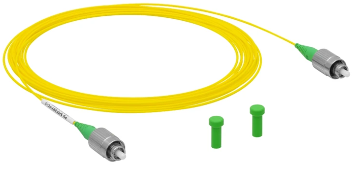
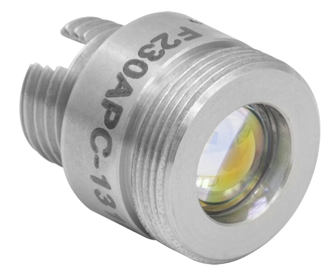
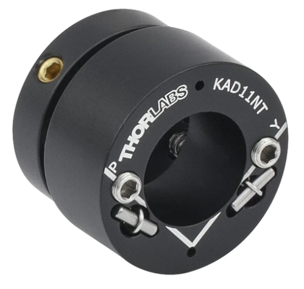
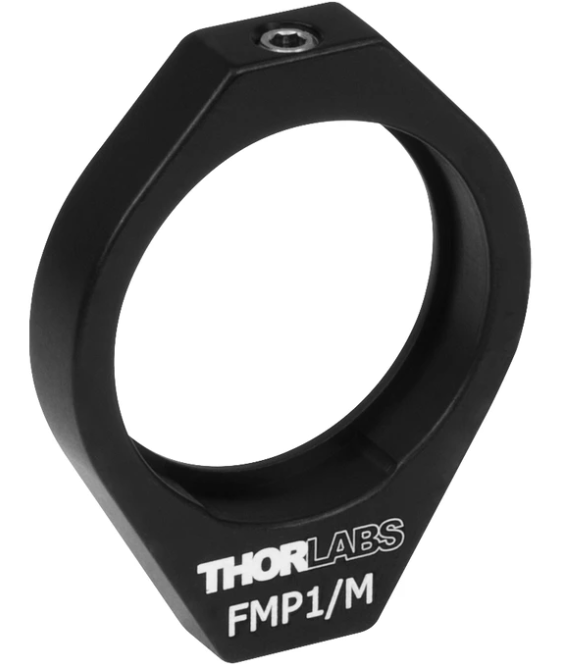

# Excitation arrière (partie dans la boite pour le freecad)

## Fibre optique pour l'excitation : 

- [fibre optique](https://www.thorlabs.com/item/P3-SMF28Y-FC-5) de chez Thorlabs :
    - Monomode à 1310 nm
    - Coupure à 1260 nm (et 1625)
    - Connecteur FC/APC
    - MFD (Mode Field Diameter) de 9,2 $\pm$ 0,4 $\mu$ m
    - Longueur à choisir, ici 5m
    - Rien de spécifique pour la polarisation. A determiner si ça a une importance

    

## Collimateur pour la fibre optique d'excitation : 

- [Collimateur](https://www.thorlabs.com/item/F230APC-1310) de chez Thorlabs :
    - Fabriqué pour 1310 nm
    - focale de f = 4.59 mm
    - NA = 0.54 
    - FC/APC
    - [Diamètre du faisceau en sortie = 0.83 mm](../../Elements_de_theorie/Optique/Diametre_faisceau_excitation_arriere/Diametre_faisceau_excitation_arriere.md)
    - [Longueur de Rayleigh]() de 0,41 m

    

Comme la table fait moins de 20cm, on est tranquille avec $z_R$ = 0,41 m.

## Adaptateur pour collimateur : 

- [Adaptateur](https://www.thorlabs.com/item/KAD11NT) de chez Thorlabs :
    - 2 vis pour les 2 directions, permet de coupler la fibre avec la lentille sur mesure de Yannick
    - Possède le bon diamètre intérieur pour accueillir le collimateur (1").

## Support fixe

- [Support fixe](https://www.thorlabs.com/item/FMP1_M) de chez Thorlabs.
- [Tige](https://www.thorlabs.com/item/TR75V_M). 75 mm par exemple. Doit pouvoir atteindre la hauteur de la table optique depuis le "sol".

## Ensemble excitation arrière + lentille sur mesure 

La sortie de l'excitation arrière et la lentille sur mesure peuvent spatialement se suivre, le faisceau étant collimaté. 
Cependant, l'ensemble doit être sur une "platine" comprenant un axe z, pour pouvoir deplacer la lentille sur mesure jusqu'à être à bonne distance du substrat en verre de 3mm. Cela peut éventuellement seulement concerner la lentille sur mesure. En effet, peu importe la distance entre la sortie de fibre et la lentille. On peut donc envisager de mettre la sortie de fibre en dehors de la table optique (peu importe les vibrations de cette partie du setup).

Problème : Si l'ensemble n'est pas solidaire de la table optique, c'est impossible à aligner en dehors de la booite :/ Je pense qu'il faut essayer de l'inclure à la table optique en premier lieu.

## Echantillon

Pour les premiers tests, on ne veut pas d'émetteurs mais seulement un DBR pour fermer la cavité.