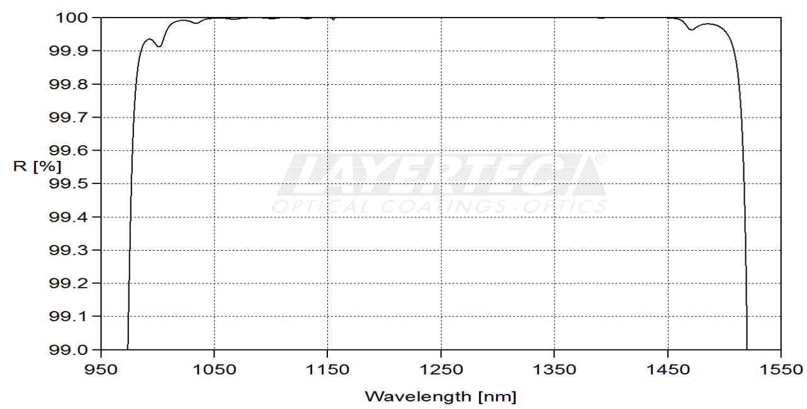
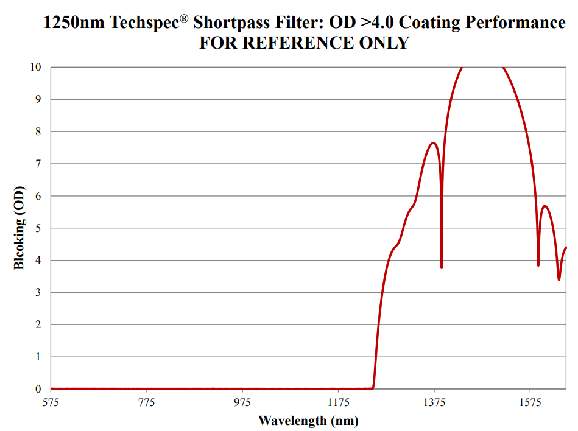
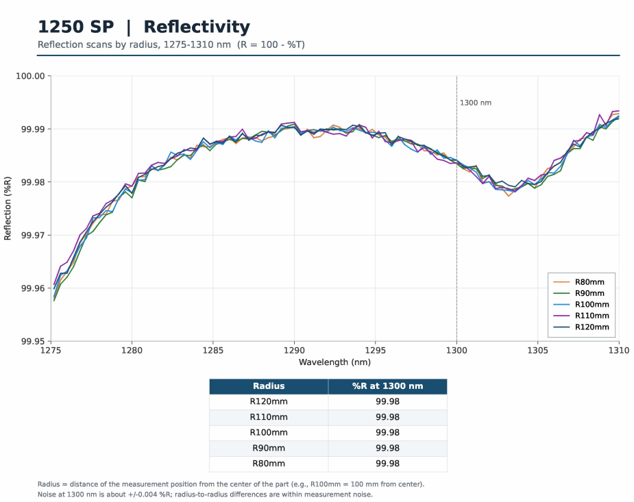

# Recherche de DBR dans le commerce 

On cherche un miroir diélectrique qui soit :
    - Centré autour de 1310 nm
    - à 0° d'angle d'incidence
    - Sur un fused silica de 3mm pour matcher la lentille de Yannick
    - De diamètre 1/2" (12,7 mm)
    - D'une reflectivité de 99.95% au moins

## Miroirs chez Layertec :

- [Bragg chez Layertec](https://www.layertec.de/en/shop/datasheet-107547/?utm_source=chatgpt.com) :
    - Fait 6mm d'épaisseur :/
    - Possibilité de le faire sur mesure

- [Bragg chez Thorlabs](https://www.thorlabs.com/item/BB05-E04) :
    - Fait 6mm d'épaisseur également
    - Reflectivité pas assez bonne à 6° (Pas de doc à 0° ...)

- [Shortpass chez Layertec](https://www.layertec.de/en/shop/datasheet-doc/113787/1)
    - Il a tout ce qu'il faut celui la.
    - La reflectivité est pas 99.95%, mais au dessus de 99.6% sur 1000-1500 nm. Elle est probablement trop grande sur la bande qui nous intéresse. Il n'est pas en stock, c'est équivalent à le commander sur mesure 

- [Shortpass chez Edmund](https://www.edmundoptics.fr/p/1250nm-25mm-diameter-od-4-shortpass-filter/32134/) qui correspond parfaitmeent à ce qu'on veut :
    - diamètre 25,0 mm (prendre un support adapté)
    - épaisseur de 3,0 mm (super pour la lentille de Yannick)
    -  
    - Une reflectivité autour de 5 décades à 1300 nm (demander à Edmund une coubre mesurée, ici on a le blocking, mais pas la rélexion.)  

- Une demande de courbe de reflectivité plutôt que de blocking a été demandé à Edmund.

- Voilà la courbe de réflectivité du shortpass : 

- Elle indique R = 99.98 % autour de 1300 nm ! 

- Problème : la mesure indique R = 100 - T. C'est juste un zoom de la courbe qu'on avait déjà. 

- Cependant :
    - La mesure en fonction du rayon est là parce que le shortpass vient d'un wafer circulaire. Et il a l'air homogène. J'imagine que ça veut dire une diffusion assez faible du matériau. Sachant aussi que c'est industriel, ça doit être optimisé.
    - L'absorption doit pouvoir se trouver, étant donné qu'on connait probablement le matériau et son indice. Elle est bulk, le truc est hyper fin, je pense que c'est ok.
    - On estv à 99.98%, c'est pas un drame si ça diminue un poil non ? 

