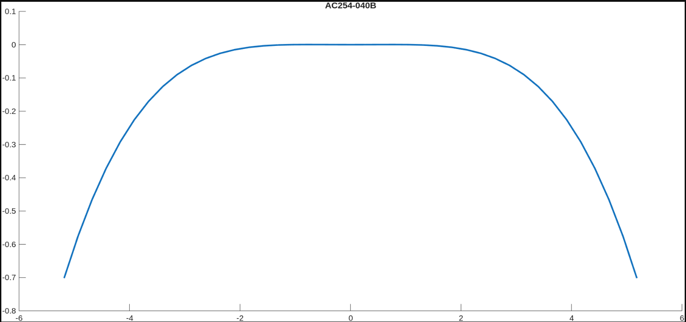

# Création de l'excitation arrière :

## Type de fibre 

- [P3-1064Y-FC-5](https://www.thorlabs.com/item/P3-1064Y-FC-5) :
    - Taille du MFD (Mode field diameter) : MFD = 6 um à 1030 nm (environ)
    - Le waist $w_0$ vaut donc 3 um
    - Si on suppose le mode Gaussien, on a :
        - $\theta = \frac{\lambda}{\pi w_0}$
        - $\theta$ = 0.107 rad (6.1°) à peu près. Légerement différent de la N.A spécifiée, qui vaut 0.14 

## Doublet pour collimater la fibre :

- On veut un faisceau d'à peu près 8.5 mm de diamètre avant le beam expander. Sachant que le diamètre du faisceau sera de $D = 2f\theta$, on a :
    - f = 39.7 mm 
- On veut une surface "claire" d'à peu près 10 mm. 

- Il existe la [AC254-040-B-ML](https://www.thorlabs.com/item/AC254-040-B-ML) :
    - 1" 
    - Grande mais au moins on ne clip pas. 
    - Je ne trouve rien d'autre en 40 mm de focale (pas de 1/2 ")
    - On peut quand même utiliser des miroirs de 1/2" derrière !

- Yannick a calculé les abérrations spéhriques et le front d'onde pour ce doublet achromatique là : 

  

C'est super, et la AC254-040B nous satisfait pleinement.

## Beam expander en x2 : Fait maison

Pour la première lentille, on veut utiliser un doublet achromatique divergent. Seuls les doublets non montés sont divergents .. 

Pour un x2, voilà les options :

### Configuration 1 : Première lentille de 1/2"

- Un doublet divergent de 1/2": 
    - [ACN127-030-B](https://www.thorlabs.com/item/ACN127-030-B)
        - f = -30 mm
        - n = 1.6380 pour la première 
        - n = 1.7743 pour la deuxième
- Un doublet convergent de 1":
    - [AC254-060-B](https://www.thorlabs.com/item/AC254-060-B)
        - f = 60 mm
        - n = 1.6380 pour la première 
        - n = 1.7743 pour la deuxième

## Configuration 2 : Première lentille de 1" 

- Un doublet divergent de 1":   
    - [ACN254-040-B](https://www.thorlabs.com/item/ACN254-040-B)
        - f = -40 mm
        - n = 1.6546 pour la première 
        - n = 1.7743 pour la deuxième
- Un doublet convergent de 1":
    - [AC254-080-B](https://www.thorlabs.com/item/AC254-080-B)
        - f = 80 mm
        - n = 1.6546 pour la première 
        - n = 1.7743 pour la deuxième

