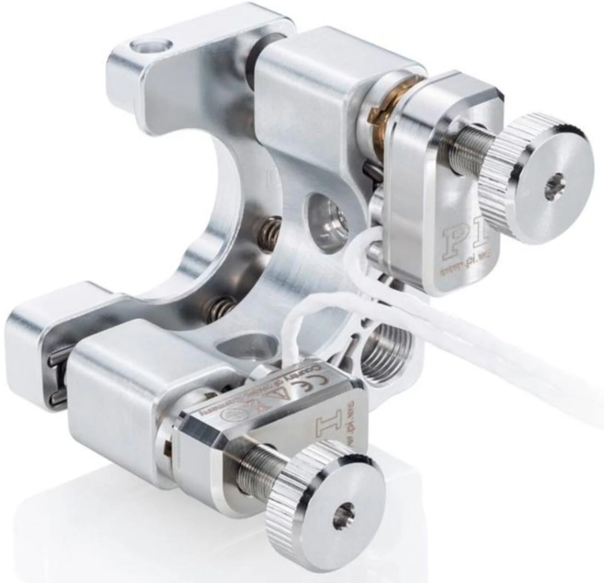
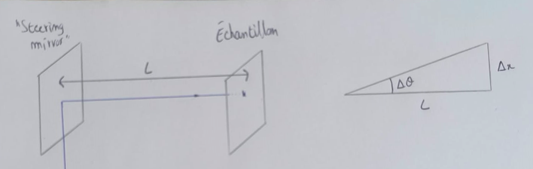
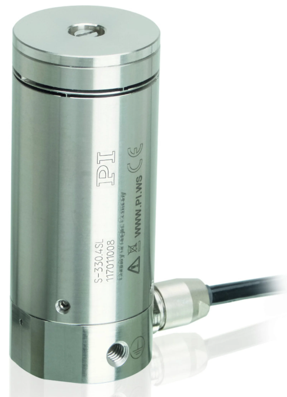
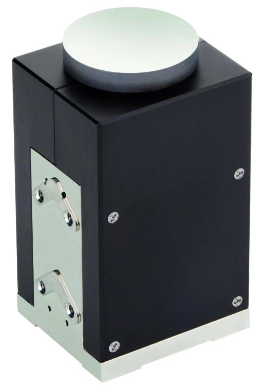

# Recherche d'un steering mirror ou d'un équivalent qui aille sous vide

## Le N-480 High-Precision Kinematic Mirror Mount de chez PI

### Quel serait le pas du scan ?

[Lien pour le miroir](https://www.pifrance.fr/fr/products/linear-actuators/piezomike-for-long-term-stability/n-480-high-precision-kinematic-mirror-mount-1000171)

Photo du miroir :

  

- Les caractéristiques données sont (pour le N-480.210CV par exemple):
    - Un pas angulaire de 0.5 $\mu$ rad
    - Une course de $\pm$ 8°

- On veut savoir les caractéristiques du scan que ça représenterait.
    - On appelle la distance entre le "steering mirror" et l'échantillon L
    - On appelle le pas angulaire $\Delta \theta$
    - On appelle le pas du scan résultant $\Delta x$

Voici le schéma de la situation :

  

- Pas de $\Delta \theta$ du miroir correspond à un pas effectif du rayon de $2\Delta \theta$. On a alors :
    - $\Delta x = L \cdot tan(2\Delta \theta)$
    - Etant donné les faibles angles, on a l'approxiamtion $tan(\theta) \approx \theta$ :
        - $\Delta x = L \cdot 2\Delta \theta$ soit $\Delta x = L \cdot 2\Delta \theta$
    - $\Delta x \approx 0,1 \cdot 0,5 * 10^{-6}$
    - $\Delta x \approx 50 nm$

- On aurait un pas de 50 nm.

### Quelle serait la course du scan ?

- Quel est le nombre $N$ de pas ? 
    - La course du miroir est de $\pm$ 8°, avec des pas de 0,5 $\mu$ rad $\approx$ $3x10^{-5}$°
    - N $\approx 16/3 * 10^{-5} \approx 5,6 * 10^{5}$

- Quelle est la distance couverte par le scan dans une direction ?
    - Distance = distance pas * nombre de pas
    - $L_{SCAN} = 50 * 10^{-9} \cdot 5,6 * 10^5$
    - $L_{SCAN} = 28$ mm

- On aurait une course de 28 mm dans chaque direction.

### Problème majeur

Le problème de ce type de montage est le fonctionnement en **stick and slip** de ces moteurs. 

## Autre possibilité : S-330 Fast Piezo Tip/Tilt Platform

  

[Lien](https://www.pifrance.fr/fr/products/nanopositioning-piezo-flexure-stages/piezo-flexure-tilting-mirrors/s-330-fast-piezo-tiptilt-platform-300700)

- Le modèle S-330.8SL / .8SH possède :
    - Une compatbilité vide (10$^{-10}$ mbar)
    - Une course de 10 mrad (donc le faisceau 20 mrad)
    - Un pas de 20 nrad minimum
    - Une "position absolue", avec en tout cas une boucle fermée !
    - c'est conçu pour faire du scanning
    - tension analogique et courbure continue ! Comme le fonctionnement des piezotubes
    - spécifié pour miroir jusqu'à 50 mm de dimètre.

- 20 mrad ça donne 4mm de scan si y'a 10cm de distance entre le miroir et l'échantillon.

- Le vrai problème reste le prix (et l'alimentation). J'ai pas de devis mais ca va faire 10 000 euros.
- Et la précision : 20 nrad ne sert absolument pas ici, par rapport à la limite de diffraction.
- Avec un pas de 1 urad et 10cm entre miroir et échantillion, on scanne à 200 nm (par rapport à 1300 nm de spot en gros).

- [Devis envoyé](https://webmail.phys.ens.fr/SOGo/so/jais/Mail/view#!/Mail/0/INBOX/390) (S-330.8SH et E-727.3SDAP).

## Autre possibililté : S-335.2SH moins de précision et course plus grande

  

[Lien](https://www.pifrance.fr/fr/products/nanopositioning-piezo-flexure-stages/piezo-flexure-tilting-mirrors/s-335-piezo-tiptilt-platform-300711)

[Vacuum](https://motionsystems.pi-usa.us/category/irrors-active-optics-multi-axis-tip-tilt-platforms) compatible :

- Caractéristiques :
    - 70 mrad de déviation du faisceau (ça fait 14 mm).
    - boucle fermée
    - se pilote avec le E-727.3 SD

- [Devis envoyé](https://webmail.phys.ens.fr/SOGo/so/jais/Mail/view#!/Mail/0/INBOX/389) (E-727.3SD et S-335.2SH).

## Autre possibilité : Faire un steering mirror en dehors de la boite 

- On peut envisager de faire un steering mirror en dehors de la boite :
    - On achete une vitre pour faire passer l'ecxitation
    - Une autre en face pour la sortie
    - On aligne l'excitation 

    A completer
