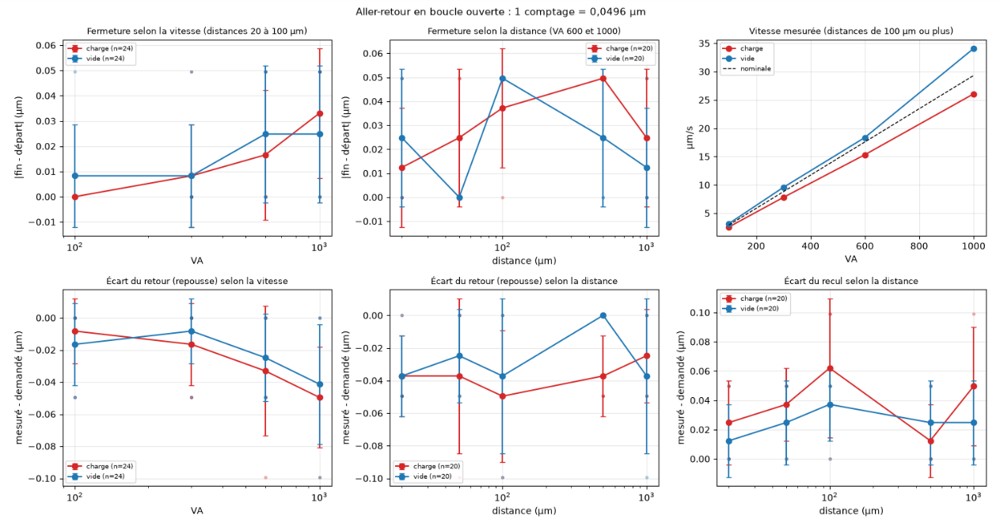

# Test du moteur 8311 de chez newport avec et sans charge :

Le test se trouve [dans ce notebook](/campagne_picomoteurs.ipynb).

Voilà 6 grandeurs mesurées : 

On peut en conclure que, à part la vitesse mesurée qui baisse avec la charge, l'erreur est stationnaire et nulle dans les 2 configurations, peu importe la vitesse ou la distance parcourue. 

Il y a cependant un énorme problème, le 8311 ne rentre pas en x/y, mais seulement en z !!!! A checker avec newport, ou a voir avec l'atelier. Il faudrait poncer la platine, ou la "couper".